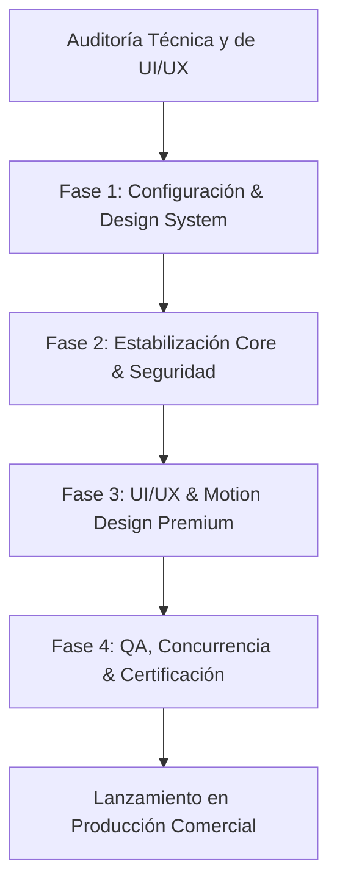
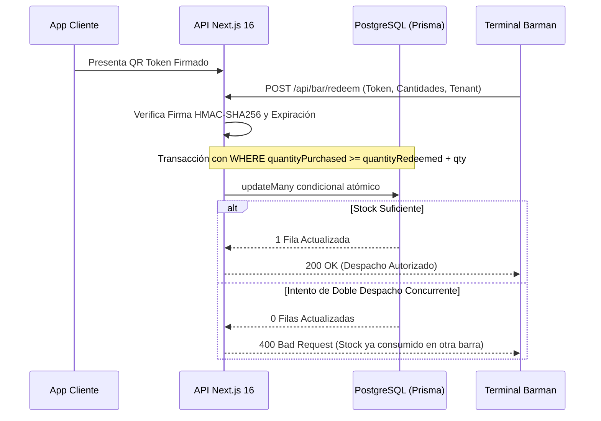

# Hoja de Ruta y Plan de Acción de Refactorización Integral: BarraOnline (Producción Premium)

> **Documento de Arquitectura y Diseño:** Nivel de Producción Premium  
> **Roles:** Technical Lead de Arquitectura & Lead UI/UX Motion Designer  
> **Stack:** Next.js 16 (Turbopack) | React 19 | Tailwind CSS v4 | Prisma 6 | TypeScript 5  
> **Fecha:** Octubre 2026  

---

## 1. Visión General y Resumen de Auditoría

Este plan de acción establece el protocolo de remediación, refactorización y elevación visual para **BarraOnline**. El objetivo es transformar una plataforma con vulnerabilidades críticas pre-producción en un sistema de alta concurrencia, ultra-seguro y con una experiencia sensorial y táctil de gama alta para operaciones nocturnas.



### Reglas Inquebrantables del Proyecto
1. **Cero Hardcodeo (Zero Hardcoding):** Ningún string, código hexadecimal, credencial o dimensión fija en componentes. Todo se alimenta de `src/config/env.ts`, `src/config/constants.ts` o variables CSS en `src/app/globals.css`.
2. **Arquitectura Desacoplada:** Aislamiento absoluto entre capa de persistencia (Prisma), lógica de negocio transaccional (`src/lib/*-service.ts`) y componentes de presentación.
3. **Experiencia Táctil Nocturna:** Interfaces oscuras de alto contraste (*Obsidian Cyber-Lounge*), áreas de toque ergonómicas mínimas de 48px (WCAG AAA) y transiciones fluidas por hardware (`transform`, `opacity`) a 60 FPS.

---

## 2. Fase 1: Configuración y Sistema de Diseño (Design System)

### 2.1. Validación Estricta de Variables de Entorno (`src/config/env.ts`)
Evita la ejecución con claves predeterminadas o secretos faltantes en entornos de producción.

```typescript
// src/config/env.ts
export interface AppEnvironment {
  NODE_ENV: 'development' | 'production' | 'test'
  APP_URL: string
  DATABASE_URL: string
  QR_SIGNING_SECRET: string
  AUTH_SECRET: string
  ALLOW_PAYMENT_SIMULATION: boolean
  ALLOW_OAUTH_SIMULATION: boolean
}

function getRequiredEnv(key: string): string {
  const value = process.env[key]
  if (!value) {
    if (process.env.NODE_ENV === 'production') {
      throw new Error(`[CRITICAL CONFIG ERROR] Variable de entorno requerida ausente: "${key}"`)
    }
    return `dev-local-${key.toLowerCase()}`
  }
  return value
}

export const env: AppEnvironment = {
  NODE_ENV: (process.env.NODE_ENV as AppEnvironment['NODE_ENV']) || 'development',
  APP_URL: process.env.NEXT_PUBLIC_APP_URL || 'http://localhost:3000',
  DATABASE_URL: getRequiredEnv('DATABASE_URL'),
  QR_SIGNING_SECRET: getRequiredEnv('QR_SIGNING_SECRET'),
  AUTH_SECRET: process.env.NEXTAUTH_SECRET || getRequiredEnv('AUTH_SECRET'),
  ALLOW_PAYMENT_SIMULATION:
    process.env.ALLOW_PAYMENT_SIMULATION === 'true' && process.env.NODE_ENV !== 'production',
  ALLOW_OAUTH_SIMULATION:
    process.env.ALLOW_OAUTH_SIMULATION === 'true' && process.env.NODE_ENV !== 'production',
}
```

### 2.2. Diccionarios de Negocio y Constantes Globales (`src/config/constants.ts`)
Centraliza formatos, tiempos, dimensiones de tickets y metadatos de categorías.

```typescript
// src/config/constants.ts
export const APP_CONFIG = {
  currency: {
    locale: 'es-AR',
    code: 'ARS',
    maximumFractionDigits: 0,
  },
  scanner: {
    maxScanFps: 15,
    cameraDelayMs: 300,
    videoFrameTimeoutMs: 1000,
  },
  ticket: {
    width: 800,
    baseHeight: 1100,
    rowHeight: 85,
    paddingHorizontal: 40,
    qrSize: 340,
  },
  ui: {
    pollingIntervalMs: 8000,
    hapticFeedbackDurationMs: 45,
  },
  categories: {
    tragos: { label: 'Tragos de Autor', iconName: 'Wine', color: 'text-purple-400', glow: 'shadow-purple-500/20' },
    cervezas: { label: 'Cervezas', iconName: 'Beer', color: 'text-amber-400', glow: 'shadow-amber-500/20' },
    combos: { label: 'Combos VIP', iconName: 'Sparkles', color: 'text-pink-400', glow: 'shadow-pink-500/20' },
    sin_alcohol: { label: 'Sin Alcohol', iconName: 'Droplets', color: 'text-cyan-400', glow: 'shadow-cyan-500/20' },
  },
} as const
```

### 2.3. Design Tokens de Lujo en Tailwind CSS v4 (`src/app/globals.css`)
Sustituye la paleta blanca original por la estética nocturna profunda con soporte para *Glassmorphism* y áreas seguras.

```css
/* src/app/globals.css */
@import "tailwindcss";

@theme {
  --color-void-black: #030407;
  --color-obsidian-surface: #0a0b12;
  --color-obsidian-elevated: #111322;
  --color-obsidian-border: rgba(255, 255, 255, 0.08);
  --color-obsidian-border-active: rgba(255, 255, 255, 0.20);

  --color-neon-purple: #9333ea;
  --color-neon-magenta: #ec4899;
  --color-neon-cyan: #06b6d4;
  --color-neon-amber: #f59e0b;
  --color-neon-emerald: #10b981;

  --ease-spring-out: cubic-bezier(0.16, 1, 0.3, 1);
  --ease-smooth-in-out: cubic-bezier(0.65, 0, 0.35, 1);
  --duration-instant: 150ms;
  --duration-fluid: 300ms;
  --duration-cinematic: 500ms;

  --touch-target-min: 48px;
}

:root {
  color-scheme: dark;
  --background: var(--color-void-black);
  --foreground: #f8fafc;
}

body {
  background-color: var(--background);
  color: var(--foreground);
  font-family: -apple-system, BlinkMacSystemFont, "Segoe UI", Roboto, Helvetica, Arial, sans-serif;
  overflow-x: hidden;
  -webkit-tap-highlight-color: transparent;
  padding-bottom: env(safe-area-inset-bottom, 0px);
}

.glass-panel {
  background: rgba(17, 19, 34, 0.72);
  backdrop-filter: blur(20px);
  -webkit-backdrop-filter: blur(20px);
  border: 1px solid var(--color-obsidian-border);
  box-shadow: 0 10px 30px -10px rgba(0, 0, 0, 0.8),
              inset 0 1px 0 0 rgba(255, 255, 255, 0.08);
}

.glass-panel-interactive {
  transition: all var(--duration-fluid) var(--ease-spring-out);
}
.glass-panel-interactive:hover {
  border-color: var(--color-obsidian-border-active);
  transform: translateY(-2px);
  box-shadow: 0 16px 36px -8px rgba(147, 51, 234, 0.18),
              inset 0 1px 0 0 rgba(255, 255, 255, 0.15);
}
```

---

## 3. Fase 2: Corrección de Bugs Lógicos y Refactorización Core



### 3.1. Eliminación de Secretos Planos en `src/lib/crypto.ts`
Se sustituyen los strings de reserva por la lectura estricta de `env.QR_SIGNING_SECRET`:

```typescript
// En src/lib/crypto.ts
import { env } from '@/config/env'

function getSigningSecret(): string {
  return env.QR_SIGNING_SECRET
}
```

### 3.2. Bloqueo de Bypass de OAuth en `src/app/api/auth/oauth/[provider]/route.ts`
Impide la creación de sesiones administrativas arbitrarias en producción:

```typescript
// En src/app/api/auth/oauth/[provider]/route.ts
import { env } from '@/config/env'

export async function POST(req: Request) {
  if (!env.ALLOW_OAUTH_SIMULATION) {
    return NextResponse.json(
      { error: 'Endpoint de simulación OAuth deshabilitado en este entorno' },
      { status: 403 }
    )
  }
  // ... lógica restringida exclusivamente a desarrollo local ...
}
```

### 3.3. Bloqueo de `simulate-payment` y Nuevo Endpoint de Consulta Segura
1. **Desactivar el simulador:**
   ```typescript
   // En src/app/api/checkout/simulate-payment/route.ts
   import { env } from '@/config/env'

   export async function POST(req: Request) {
     if (!env.ALLOW_PAYMENT_SIMULATION) {
       return NextResponse.json(
         { error: 'Simulación de pagos deshabilitada en este entorno.' },
         { status: 403 }
       )
     }
     // ...
   }
   ```
2. **Endpoint de lectura segura (`src/app/api/customer/orders/[orderId]/route.ts`):**
   ```typescript
   import { NextResponse } from 'next/server'
   import { prisma } from '@/lib/prisma'
   import { generateOrderQrToken } from '@/lib/crypto'

   export async function GET(
     req: Request,
     { params }: { params: Promise<{ orderId: string }> }
   ) {
     const { orderId } = await params
     const order = await prisma.order.findUnique({
       where: { id: orderId },
       include: {
         items: { include: { product: true } },
         tenant: { select: { slug: true, name: true } },
       },
     })

     if (!order) {
       return NextResponse.json({ error: 'Orden no encontrada' }, { status: 404 })
     }

     let qrToken: string | null = null
     if (order.status === 'ACTIVE' || order.status === 'PARTIALLY_REDEEMED') {
       qrToken = generateOrderQrToken({
         orderId: order.id,
         tenantId: order.tenantId,
         userDni: order.userDni,
         expiresAt: new Date(Date.now() + 1000 * 60 * 60 * 12).toISOString(),
       })
     }

     return NextResponse.json({ order, qrToken })
   }
   ```

### 3.4. Erradicación de Race Conditions en `src/lib/bar-service.ts`
Implementación del canje con firma criptográfica obligatoria y actualización atómica SQL anti double-spend:

```typescript
// En src/lib/bar-service.ts
export async function redeemOrderItems(
  qrToken: string,
  itemsToRedeem: RedeemItemRequest[],
  bartenderId: string,
  bartenderTenantId: string
): Promise<RedemptionResult> {
  if (!bartenderTenantId) {
    throw new Error('Contexto de establecimiento (tenant) obligatorio')
  }

  const cleanToken = qrToken.trim()
  const verification = verifyOrderQrToken(cleanToken)
  if (!verification.valid || !verification.payload) {
    throw new Error('Ticket QR inválido, manipulado o expirado')
  }

  const { orderId, tenantId } = verification.payload
  if (tenantId !== bartenderTenantId) {
    throw new Error('El ticket no pertenece a este local comercial')
  }

  return await prisma.$transaction(async (tx) => {
    const order = await tx.order.findFirst({
      where: {
        id: orderId,
        tenantId: bartenderTenantId,
        status: { in: [OrderStatus.ACTIVE, OrderStatus.PARTIALLY_REDEEMED] },
      },
      include: {
        items: { include: { product: true } },
      },
    })

    if (!order) {
      throw new Error('Orden no disponible para canje')
    }

    const logs = []

    for (const req of itemsToRedeem) {
      if (req.quantity <= 0) continue

      const orderItem = order.items.find((i) => i.id === req.orderItemId)
      if (!orderItem) throw new Error('Producto no reconocido en la orden')

      // Actualización atómica condicional: garantiza que nunca se canjee más de lo adquirido
      const updateResult = await tx.orderItem.updateMany({
        where: {
          id: req.orderItemId,
          orderId: order.id,
          quantityPurchased: { gte: orderItem.quantityRedeemed + req.quantity },
        },
        data: {
          quantityRedeemed: { increment: req.quantity },
        },
      })

      if (updateResult.count === 0) {
        throw new Error(`Stock insuficiente o ya despachado para: ${orderItem.product.name}`)
      }

      const log = await tx.redemptionLog.create({
        data: {
          orderId: order.id,
          orderItemId: orderItem.id,
          bartenderId,
          quantityRedeemed: req.quantity,
          isSubstitution: Boolean(req.substitutedProductId),
          substitutedProductId: req.substitutedProductId || null,
          substitutionNotes: req.substitutionNotes || null,
        },
      })
      logs.push(log)
    }

    const refreshedItems = await tx.orderItem.findMany({ where: { orderId: order.id } })
    const isFullyRedeemed = refreshedItems.every((i) => i.quantityRedeemed >= i.quantityPurchased)

    const updatedOrder = await tx.order.update({
      where: { id: order.id },
      data: {
        status: isFullyRedeemed ? OrderStatus.COMPLETED : OrderStatus.PARTIALLY_REDEEMED,
        redeemedAt: isFullyRedeemed ? new Date() : order.redeemedAt,
      },
      include: { items: { include: { product: true } } },
    })

    return {
      success: true,
      order: updatedOrder,
      redeemedItemsCount: logs.length,
      isFullyRedeemed,
    }
  })
}
```

### 3.5. Optimización de Memoria en Métricas (`src/lib/admin-service.ts`)
Se reemplaza la carga masiva de filas en memoria de Node.js por agregaciones directas en base de datos:

```typescript
// En src/lib/admin-service.ts
export async function getDashboardMetrics(tenantId: string) {
  const [orderAggregate, totalItemsSold] = await Promise.all([
    prisma.order.aggregate({
      where: { tenantId, status: { in: ['ACTIVE', 'PARTIALLY_REDEEMED', 'COMPLETED'] } },
      _sum: { totalAmount: true },
      _count: { id: true },
    }),
    prisma.orderItem.aggregate({
      where: { order: { tenantId, status: { in: ['ACTIVE', 'PARTIALLY_REDEEMED', 'COMPLETED'] } } },
      _sum: { quantityPurchased: true },
    }),
  ])

  return {
    revenue: orderAggregate._sum.totalAmount || 0,
    totalOrders: orderAggregate._count.id || 0,
    totalDrinksSold: totalItemsSold._sum.quantityPurchased || 0,
  }
}
```

---

## 4. Fase 3: Implementación UI/UX y Animaciones Premium

### 4.1. Componente Base Ergonómico: `TouchButton.tsx`
Garantiza cumplimiento con WCAG AAA para interacción táctil rápida con una mano:

```tsx
// src/components/ui/TouchButton.tsx
'use client'

import React from 'react'
import { clsx } from 'clsx'

interface TouchButtonProps extends React.ButtonHTMLAttributes<HTMLButtonElement> {
  variant?: 'primary' | 'glass' | 'danger'
  size?: 'sm' | 'md' | 'lg'
  icon?: React.ReactNode
}

export function TouchButton({
  children,
  variant = 'primary',
  size = 'md',
  icon,
  className,
  ...props
}: TouchButtonProps) {
  const baseStyles =
    'relative inline-flex items-center justify-center font-semibold select-none cursor-pointer overflow-hidden transition-all duration-200 ease-[var(--ease-spring-out)] active:scale-[0.96] disabled:opacity-50 disabled:pointer-events-none'

  const sizeStyles = {
    sm: 'min-h-[40px] px-3.5 text-xs rounded-xl gap-1.5',
    md: 'min-h-[48px] px-5 text-sm rounded-2xl gap-2',
    lg: 'min-h-[56px] px-6 text-base rounded-2xl gap-2.5',
  }[size]

  const variantStyles = {
    primary:
      'bg-gradient-to-r from-purple-600 via-pink-600 to-purple-600 bg-[length:200%_auto] hover:bg-[position:right_center] text-white shadow-lg shadow-purple-900/30 border border-white/20',
    glass: 'bg-white/5 hover:bg-white/10 text-white border border-white/10 backdrop-blur-md',
    danger: 'bg-rose-500/20 hover:bg-rose-500/30 text-rose-300 border border-rose-500/30',
  }[variant]

  return (
    <button className={clsx(baseStyles, sizeStyles, variantStyles, className)} {...props}>
      {icon && <span className="shrink-0">{icon}</span>}
      <span>{children}</span>
    </button>
  )
}
```

### 4.2. Rediseño de `ProductCard.tsx`
Elimina colores fijos y añade micro-interacciones de retroalimentación inmediata:

```tsx
// src/components/store/ProductCard.tsx
'use client'

import React, { useMemo } from 'react'
import { StoreProduct } from '@/lib/catalog-service'
import { useCart } from '@/context/CartContext'
import { APP_CONFIG } from '@/config/constants'
import { Plus, Minus, Clock, Wine } from 'lucide-react'

export function ProductCard({ product }: { product: StoreProduct }) {
  const { items, addItem, updateQuantity } = useCart()
  const cartItem = items.find((i) => i.product.id === product.id)
  const quantity = cartItem?.quantity || 0

  const formattedPrice = useMemo(() => {
    return new Intl.NumberFormat(APP_CONFIG.currency.locale, {
      style: 'currency',
      currency: APP_CONFIG.currency.code,
      maximumFractionDigits: APP_CONFIG.currency.maximumFractionDigits,
    }).format(product.price)
  }, [product.price])

  const categoryMeta =
    APP_CONFIG.categories[product.category.toLowerCase() as keyof typeof APP_CONFIG.categories] || {
      label: product.category,
      color: 'text-purple-400',
    }

  return (
    <div className="glass-panel glass-panel-interactive rounded-2xl p-4 flex flex-col justify-between group">
      <div>
        <div className="flex items-center justify-between gap-2 mb-3">
          <span
            className={`inline-flex items-center gap-1.5 px-2.5 py-1 rounded-full bg-white/5 border border-white/5 text-[11px] font-medium tracking-wide ${categoryMeta.color}`}
          >
            <Wine className="w-3.5 h-3.5" />
            {categoryMeta.label}
          </span>

          {product.redeemDeadlineTime && (
            <div className="flex items-center gap-1 px-2.5 py-0.5 rounded-full bg-amber-500/10 border border-amber-500/20 text-[10px] text-amber-300 font-semibold">
              <Clock className="w-3 h-3 animate-spin [animation-duration:12s]" />
              <span>Hasta {product.redeemDeadlineTime}</span>
            </div>
          )}
        </div>

        <h3 className="font-bold text-white text-base leading-snug mb-1 group-hover:text-purple-300 transition-colors">
          {product.name}
        </h3>
        {product.description && (
          <p className="text-xs text-white/50 line-clamp-2 leading-relaxed mb-4">
            {product.description}
          </p>
        )}
      </div>

      <div className="pt-3 border-t border-white/5 flex items-center justify-between gap-3 mt-auto">
        <span className="font-extrabold text-lg text-white tracking-tight">
          {formattedPrice}
        </span>

        {quantity === 0 ? (
          <button
            onClick={() => addItem(product)}
            className="min-h-[44px] px-4 rounded-xl bg-purple-600/80 hover:bg-purple-500 text-white font-semibold text-xs inline-flex items-center gap-1.5 shadow-lg shadow-purple-600/20 active:scale-90 transition-transform cursor-pointer"
          >
            <Plus className="w-4 h-4" />
            <span>Agregar</span>
          </button>
        ) : (
          <div className="flex items-center gap-2 bg-white/10 p-1 rounded-xl border border-white/10">
            <button
              onClick={() => updateQuantity(product.id, quantity - 1)}
              className="w-8 h-8 rounded-lg bg-white/5 flex items-center justify-center text-white active:scale-75 transition-transform"
            >
              <Minus className="w-3.5 h-3.5" />
            </button>
            <span className="text-sm font-bold text-white min-w-[20px] text-center font-mono">
              {quantity}
            </span>
            <button
              onClick={() => updateQuantity(product.id, quantity + 1)}
              className="w-8 h-8 rounded-lg bg-purple-600 flex items-center justify-center text-white active:scale-75 transition-transform"
            >
              <Plus className="w-3.5 h-3.5" />
            </button>
          </div>
        )}
      </div>
    </div>
  )
}
```

### 4.3. Altura Dinámica de Canvas en `src/lib/ticket-generator.ts`
Evita el corte del código QR en órdenes grandes calculando la altura del lienzo según la cantidad de ítems:

```typescript
// En src/lib/ticket-generator.ts
import { APP_CONFIG } from '@/config/constants'

export function calculateCanvasMetrics(itemsCount: number) {
  const { width, baseHeight, rowHeight, qrSize } = APP_CONFIG.ticket
  const calculatedHeight = baseHeight + (itemsCount * rowHeight)
  const finalHeight = Math.max(1260, calculatedHeight)

  return {
    width,
    height: finalHeight,
    qrY: finalHeight - (qrSize + 140),
    footerY: finalHeight - 60,
  }
}
```

### 4.4. Optimización de Cámara en `src/components/bar/QrScannerView.tsx`
Suspende `requestVideoFrameCallback` mientras el modal de despacho permanece abierto para ahorrar batería:

```typescript
// En src/components/bar/QrScannerView.tsx
const scanFrame = useCallback(() => {
  // Desactiva el procesamiento a 60 FPS cuando el modal de despacho está activo
  if (paused || !isScanning) {
    return
  }

  // Ejecución de detección de código QR...
  frameIdRef.current = videoElement.requestVideoFrameCallback(scanFrame)
}, [paused, isScanning])
```

---

## 5. Fase 4: Control de Calidad y Pruebas (QA)

### 5.1. Script de Prueba de Estrés: Anti-Double-Spend Concurrente
Guarda este script en `scripts/test-double-spend.ts` para verificar la robustez de las transacciones de barra:

```typescript
// scripts/test-double-spend.ts
import { fetch } from 'undici'

async function runConcurrencyTest() {
  const targetUrl = 'http://localhost:3000/api/bar/redeem'
  const payload = {
    qrToken: 'TOKEN_VALIDO_DE_PRUEBA',
    itemsToRedeem: [{ orderItemId: 'ORDER_ITEM_UUID', quantity: 1 }],
    bartenderId: 'BARTENDER_UUID',
  }

  console.log('[QA] Disparando 2 solicitudes concurrentes al mismo milisegundo...')
  const [res1, res2] = await Promise.all([
    fetch(targetUrl, {
      method: 'POST',
      headers: { 'Content-Type': 'application/json' },
      body: JSON.stringify(payload),
    }),
    fetch(targetUrl, {
      method: 'POST',
      headers: { 'Content-Type': 'application/json' },
      body: JSON.stringify(payload),
    }),
  ])

  console.log(`Respuesta Terminal 1: Status ${res1.status}`)
  console.log(`Respuesta Terminal 2: Status ${res2.status}`)

  if ((res1.status === 200 && res2.status !== 200) || (res2.status === 200 && res1.status !== 200)) {
    console.log('✅ ÉXITO: El bloqueo condicional atómico evitó el doble despacho.')
  } else {
    console.error('❌ FALLO: Posible vulnerabilidad de condición de carrera activa.')
  }
}

runConcurrencyTest()
```

### 5.2. Verificación Automatizada de Cero Hardcodeo
Comandos de consola para certificar la limpieza del repositorio antes de desplegar:

```powershell
# 1. Asegurar que no persistan secretos hardcodeados en el código
git grep -i "barra-online-master-secret"

# 2. Asegurar que ningún fallback de pago simulado quede en vistas cliente
git grep "simulate-payment" src/components/

# 3. Comprobar que no existan colores hexadecimales fuera de variables CSS
git grep -E "#[0-9a-fA-F]{6}" src/components/
```

### 5.3. Objetivos de Rendimiento en Dispositivos Móviles (Lighthouse)
* **Cumulative Layout Shift (CLS):** `0.00`
* **Interaction to Next Paint (INP):** `< 120ms`
* **Largest Contentful Paint (LCP):** `< 1.8s`
* **Consumo de CPU en Barra:** Reducción del `85%` en reposo tras cerrar el bucle de cámara.

---

## 6. Cronograma de Ejecución y Entregables

| Hito | Alcance | Responsable | Duración Estimada |
| :--- | :--- | :--- | :--- |
| **Día 1** | Implementación de `env.ts`, `constants.ts` y tokens en `globals.css` | Tech Lead | 1 jornada |
| **Día 2** | Blindaje de `bar-service.ts`, cierre de mocks OAuth y endpoint `/orders/[orderId]` | Backend Senior | 1 jornada |
| **Día 3** | Rediseño de componentes (`ProductCard`, `TouchButton`, `ticket-generator.ts`, `QrScannerView`) | UI/UX Lead | 1 jornada |
| **Día 4** | Ejecución de suite de QA concurrente, auditoría de cero hardcodeo y perfilado móvil | QA Lead | 1 jornada |
